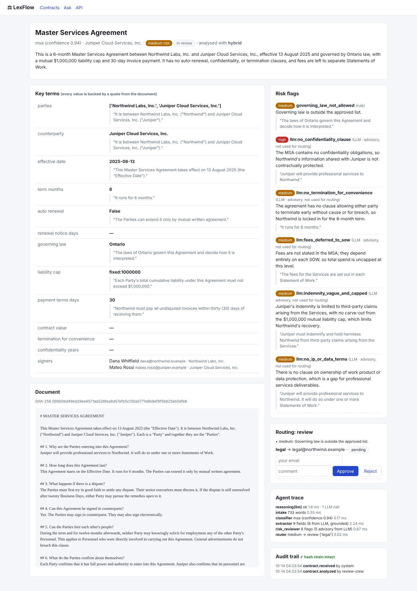
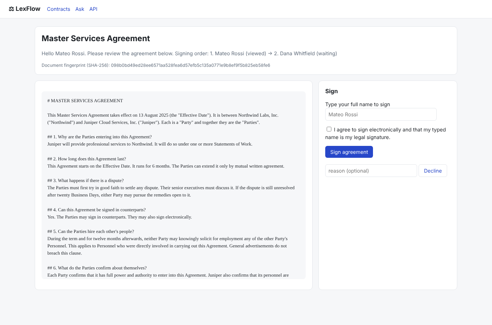
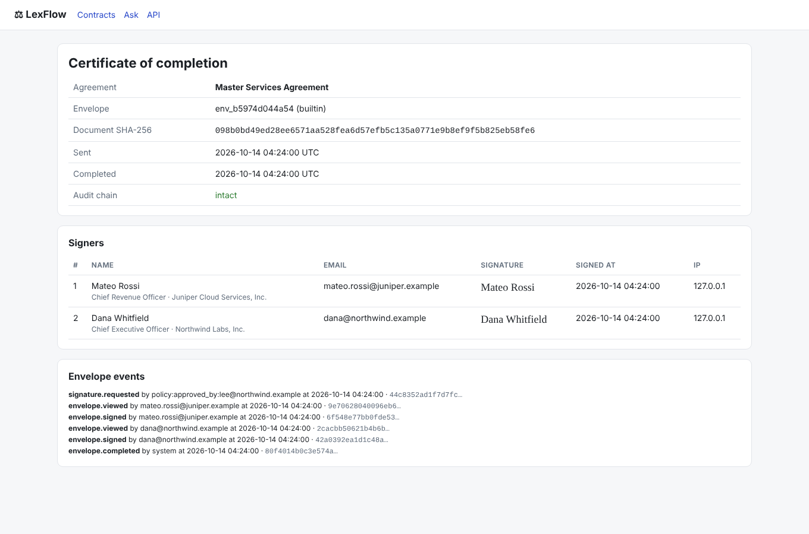

# LexFlow: Legal Agreements Agent

LexFlow is an agentic layer for managing a company's contracts, with a built-in, local DocuSign-style signing service. It reads every agreement, extracts the terms with quotes, checks them against a policy playbook, and routes each one either to signature or to the right human approvers. Once a contract is signed, it tracks renewal deadlines. Every step is audited and emitted as a hook event.

**Write-up:** [`docs/SUMMARY.md`](docs/SUMMARY.md) · **Eval report:** [`docs/eval_report.md`](docs/eval_report.md) · **Diagram:** [`docs/architecture.drawio`](docs/architecture.drawio) · **Run commands:** [`run.yaml`](run.yaml)

| Contract review | Signing | Certificate |
|---|---|---|
|  |  |  |

## Quick start

```bash
pip install -r requirements.txt
python -m pytest                    # 48 tests
python src/main.py demo              # full workflow on 9 sample contracts
python src/main.py eval --no-live    # rules vs LLM on 126 labelled contracts
python src/main.py serve             # UI + API at http://localhost:8080
```

To have the reasoning layer call `claude -p` live, set `CLAUDE_KEY` and install the Claude Code CLI. Without them, LexFlow runs rules-only, or replays the recorded LLM answers in the demo and eval.

## What happens to a contract

1. **Intake.** The file is converted to text, given a SHA-256 hash, de-duplicated, and scanned for prompt injection.
2. **Classifier.** It decides the contract type using the playbook's keywords. In hybrid mode, the LLM's answer wins if it disagrees.
3. **Extractor.** Rules and one `claude -p` call pull out 12 terms. Every LLM value must quote the document verbatim, or it's dropped.
4. **Risk reviewer.** Playbook rules and clause checks produce the risk flags. The LLM's risks are shown as advisory only.
5. **Router.** Policy alone decides, based on the highest severity: `auto_approve`, `review` (legal / GC, plus finance above $250k) or `blocked` (injection).
6. **Approvals.** Humans approve or reject in the UI or through the API.
7. **Signing.** Signers sign in order with explicit consent and a typed name. The document hash is checked, and a completion certificate is produced.
8. **Obligations.** LexFlow records the renewal-notice deadline and expiry date, and the daily `remind` job sends alerts at 90, 30 and 7 days.
9. **Ask.** Questions like *"which SaaS contracts auto-renew in 90 days?"* are turned into a validated filter, and the answer comes straight from database rows.

## Configuration (env)

| Variable | Default | Purpose |
|---|---|---|
| `DATABASE_URL` | `sqlite:///./lexflow.db` | Use a Postgres URL in production |
| `LEXFLOW_MODE` | `auto` | `rules`, `hybrid` or `auto` (`hybrid` when `CLAUDE_KEY` is set) |
| `CLAUDE_KEY` | – | Token for `claude -p` |
| `LEXFLOW_PLAYBOOK` | built-in | Path to your company's playbook YAML |
| `LEXFLOW_API_KEY` | – | Required on `/api/*` and the UI when set |
| `LEXFLOW_HOOKS` | `console` | `console`, `file:<path>`, `webhook:<url>`, `slack:<url>` (comma-separated) |
| `LEXFLOW_HOOK_SECRET` | dev value | HMAC secret for inbound and outbound hooks |
| `LEXFLOW_REDACT_PII` | `false` | Mask e-mails and phone numbers before LLM calls |

## Layout

```
src/lexflow/agents/     review.py (crew + orchestrator) · rules_extract.py · llm_extract.py · obligations.py · qa.py
src/lexflow/            service.py (workflow + gates) · guardrails.py · playbook.py · hooks.py · audit.py · llm.py
src/lexflow/signing/    providers.py (built-in e-sign, external webhook provider)
src/lexflow/            api.py (REST + HTML) · mcp_server.py · cli.py · templates/
src/lexflow/playbooks/  default.yaml (policy as data)
src/lexflow/evals/      synth.py (labelled corpus) · paraphrase.py (held-out set) · run.py (metrics) · data/
src/tests/              48 tests: units, adversarial LLM, workflow, API/hooks/MCP, evals
src/deploy/             docker-compose.yml · k8s/lexflow.yaml
```
