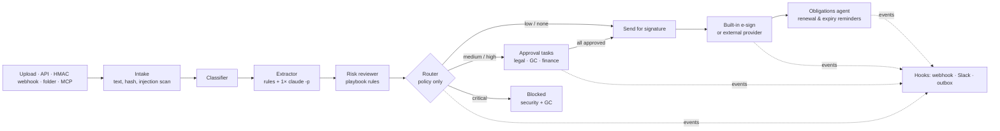

# LexFlow: an agent that runs the company's contracts

**The workflow I automated.** A contract arrives by e-mail, upload or from the CRM. Someone has to:

1. Work out what it is.
2. Pull out the terms.
3. Check them against company policy.
4. Get the right approvals.
5. Get it signed.
6. Remember the renewal deadline months later.

Today that's a paralegal, a spreadsheet and a calendar. LexFlow does it with a crew of narrow agents, a policy file and a **built-in DocuSign-style signing service**. Humans make every decision that matters.

## Design: the LLM reads, the policy decides

| Layer | What it does | Why |
|---|---|---|
| **Reasoning** (`claude -p`, 1 call per contract) | Classifies the contract and extracts 12 terms. Each value comes with a **verbatim quote**. It also suggests advisory risks and spots injection attempts. | Real contracts are worded in endless ways. On unfamiliar wording, rules recover only 69 % of facts, while the LLM recovered all of them on this set (see Evals). |
| **Policy** (`playbook/default.yaml`) | Holds contract types, required fields, clause checks, rules (`{field, op, value}`), routing, approvers and value thresholds. | Legal owns this file, not engineering. **A new contract type is a YAML block**, and a test proves it. |
| **Action** | Creates approval tasks, signing envelopes, obligations, reminders and events. Each one is gated on contract status. | Nothing is ever signed or sent unless policy or a recorded human approval allows it. |

## Guardrails (each one has a test)

1. **Untrusted input.** The contract goes into the prompt as data, never as instructions. Text aimed at an "AI reviewer" is flagged *critical* and blocks the contract until security and the GC look at it. This fires on either a regex or the LLM's own detection.
2. **Grounding.** An LLM value without an exact quote from the document is thrown away, and the rules value is used instead. The UI shows the quote next to every term.
3. **Monotonic risk.** LLM risks are *advisory*: reviewers see them, but they never change routing. A fooled model can't lower risk or unblock a contract.
4. **Action gates.**
   - `send_for_signature` refuses anything not in `ready`.
   - Signing enforces signer order, explicit e-sign consent, a typed name that matches the signer, and an **unchanged document hash**.
   - Agents can't approve: the MCP server doesn't expose approvals.
5. **Tamper evidence.** The audit log is a SHA-256 hash chain, so editing any past event breaks verification. On Postgres, an advisory lock keeps the chain from forking across replicas.
6. **Cost and privacy.** Every LLM call has a timeout and goes through a per-run call budget and a content-addressed cache. There's optional PII redaction, and a failed call always falls back to rules.

## Evals

**Datasets.**

- **templated:** 64 generated contracts across 8 types. They include distractor dates and amounts, number words, "unlimited users" placed next to capped liability, renewal *options* that aren't auto-renewals, missing clauses, and 5 prompt-injection attempts.
- **held-out:** the same facts rewritten by Claude in 4 other drafting styles. Each rewrite was machine-checked to confirm no facts were lost (62 kept).

The rules were written against the templates, so the held-out set measures how well each mode generalises to unfamiliar wording.

| dataset | mode | field acc | field recall | flag F1 | route acc | **unsafe auto-approve** | injections blocked | false blocks |
|---|---|---|---|---|---|---|---|---|
| templated | rules | 0.99 | 0.98 | 0.99 | 1.00 | **0** | 5/5 | 0/59 |
| templated | hybrid | 1.00 | 1.00 | 1.00 | 1.00 | **0** | 5/5 | 0/59 |
| held-out | rules | 0.83 | 0.69 | 0.69 | 0.92 | **0** | 5/5 | 0/57 |
| held-out | hybrid | **1.00** | **1.00** | **1.00** | **1.00** | **0** | 5/5 | 0/57 |

**What the numbers mean:**

- **The rules break on wording they weren't written for.** On the held-out set, rules got parties right only 60 % of the time and term length 66 %. The hybrid mode closes that gap.
- **Safety held in both modes.** Neither ever auto-approved a contract that needed a human; rules fail toward *more* review, not less.
- **Cost:** about 15 s and 1 `claude -p` call per contract (126 live calls, 0 failures). Rules alone take about 3 ms.
- **The 1.00 scores mean this set is too easy for the LLM.** Next: CUAD (510 real contracts with clause labels) and lawyer-reviewed samples.
- **Reproducible without a key:** the committed cache replays the recorded LLM answers (`eval --no-live`), and a test asserts zero live calls.

## Connects to anything, deploys anywhere

| | |
|---|---|
| **In** | REST API (API key) · web upload (PDF, DOCX, TXT) · HMAC-signed webhook · folder ingest · **MCP server** (other agents can review and query, but not approve) |
| **Out** | HMAC-signed webhooks · Slack · JSONL outbox, covering 12 event types. Approval requests carry deep links. |
| **Signing** | Built-in engine by default. A `WebhookProvider` hands envelopes to Documenso, DocuSeal, OpenSign or DocuSign through an adapter, and completion comes back on a signed callback. |
| **Run** | One image. SQLite on a laptop, Postgres in production. docker compose on-prem; Kubernetes Deployment plus a reminders CronJob in the cloud. Config comes only from env. |

**Not done yet:**

- OCR for scanned PDFs
- Clause redlining or negotiation
- Real e-mail delivery (events carry the links; any SMTP or Slack hook can send them)
- SSO in front of the approver UI
- A qualified e-signature certificate (the hash plus audit chain is evidence, not an eIDAS QES)
